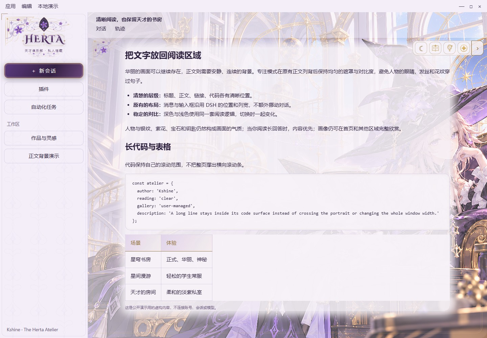
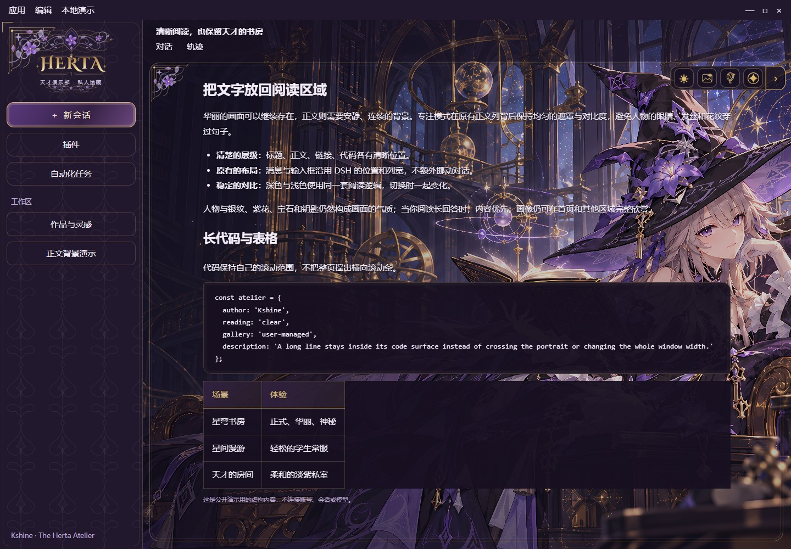

# The Herta Atelier · 大黑塔·天才书房

[代码许可：PolyForm Noncommercial 1.0.0](docs/LICENSE-SUMMARY.md) · 免费非商业使用、允许许可范围内的修改，分发保留署名

**Kshine 的非官方 DSH 主题作品 · Windows**

<!-- herta-source-version:start -->
源码版本：**0.4.0-beta.13**
<!-- herta-source-version:end -->

本版为工程整改 Beta，正式附件及每包验证回执见[beta.13发行页](https://github.com/KshineKX/the-herta-atelier/releases/tag/v0.4.0-beta.13)。本轮暂缓真实DSH安装、重启与实机验收，现用beta.11保持不动。检查与待验项见[交付状态](docs/RELEASE-REVIEW.md)，版本与构建职责见[单一源码入口](docs/SOURCE-OF-TRUTH.md)。

紫黑与晨光双主题，三组内置场景画像，以及银纹、紫花、宝石与钥匙的层叠框饰。观赏模式保留人物与场景；专注模式在宿主原有正文列背后增加柔边衬底，切换保留消息与输入框布局。面板、代码与输入框使用统一的紫调玻璃材质。

完整主题包含 **10张背景变体、3个场景、13段无声视频，共102秒**。书房5段为1820×1138，另两场景8段为1212×758，均为30fps。已完成多轮生成、书本连续性、闭嘴定位和动作衔接修订，以及安装、升级、失败恢复和精确回退验证。制作范围与费用口径见[制作记录](docs/PRODUCTION-NOTES.md)。

本项目为非官方同人主题，与 miHoYo / HoYoverse、DeepSeek 无隶属关系。角色相关权利属于相应权利方；项目许可只覆盖作者有权授权的贡献。

## 预览

以下为已发布 beta.11 的浅色与深色演示页截图，使用虚构内容，不含真实聊天；不冒充新候选的原生实机截图：





三场景动态预览：


[打开MP4预览](docs/previews/motion-beta11.mp4)。动态图取现有原片每场景3秒拼接为9秒，并缩放压缩便于网页查看；不是原生DSH录屏，也不是完整动作周期。以上预览不代替跨机、长时间运行或每个动作的完整验收。

## 第一次使用

1. 打开[beta.13发行页](https://github.com/KshineKX/the-herta-atelier/releases/tag/v0.4.0-beta.13)，下载 **The-Herta-Atelier-0.4.0-beta.13-theme.zip** 和对应 `.sha256`，核对后解压。仓库目前为私有，需要已获访问权限的GitHub账号。
2. 先运行一次DSH，保存工作并完全退出，再双击 **Install.cmd**。安装器校验并备份配置，联合安装代码和13段视频。
3. 重新打开DSH，展开右上工具条，用四角星打开设置；选择静态／动态、画像场景、观赏／专注和深浅外观。
4. 镜子按钮固定保留在工具条，点击才打开图库。**OpenGallery.cmd** 打开自己的图库目录，增删图片后重开藏镜刷新。

需要Node.js 22.19+（22.x）或24+，入口优先寻找DSH自带运行时。普通使用不要求编辑JSON/YAML、安装npm依赖，或启动作者的预览服务器。

Code → Download ZIP 是开发源码；安装用户优先使用预构建的 `-theme.zip`。源码构建方法见下方开发说明；`--core` 是显式不带画像的基础版选项，不作为默认交付。

## 特殊动作怎样触发

先在设置中选择**动态**模式：

- **长待机**：人物在150–240秒的随机低频等待后行动；输入、滚动或点击等活动会重新开始待机等待。
- **故意触碰背景**：在同一块空白背景约1.6秒内连续轻触3次；单击或双击不触发，正文、输入区、按钮等控件和真实文本选区会被排除。互动冷却为45秒。
- **书房离席后**：20–30秒后自动返回并落座。私室的仰躺与歪头动作轮换，不需要逐次点动作按钮。

后台、系统减少动画、静态模式和卸载会取消低频等待；恢复后重新等待，不累计补播。素材缺失或加载失败时显示静态画像。设置不再显示“动作播放中”等状态行或离席等动作按钮。

右上工具条平时收起，点击或停留片刻展开，闲置四秒后收起；设置或键盘操作期间保持展开。镜子入口常驻工具条，图库由用户自己管理。

## 安装、升级与回退

- 默认使用当前用户的DSH desktop profile，支持自定义DSH_HOME、profile和数据目录。
- 配置和旧链接先备份；升级保留个人图库、个人开屏、无关插件配置及首次安装前的恢复基线。
- **Rollback.cmd** 精确返回本次升级前状态；**Uninstall.cmd** 恢复首次安装前配置，两者用途不同。实际安装、升级、回退和卸载前完全退出DSH。
- **Check.cmd** 只报告状态，不修复、不重启、不改配置。宿主升级后先检查状态，再验证兼容性。

### beta.10 因标记注释消失而无法回退

beta.11 已修复宿主删除两行受管标记注释导致的误拒绝，本版完整包继续保留RecoverBeta10.cmd。[beta.11发行页](https://github.com/KshineKX/the-herta-atelier/releases/tag/v0.4.0-beta.11)另有约22KB的 **beta10-rollback-repair.zip**：无需先安装beta.11，可从原beta.10备份直接恢复其记录的升级前版本，例如beta.8。先核对SHA并执行只读预检，DSH退出后再应用。其他用户改动、配置或媒体变化仍会拒绝覆盖，原before备份保留，原回执另存。

完整步骤见[安装与回滚](docs/INSTALL.md)，环境边界见[兼容范围](docs/COMPATIBILITY.md)，执行记录见[验收记录](docs/ACCEPTANCE.md)。

## 当前状态与验证范围

beta.12发布准备已在正常Windows上下文执行完整74项测试，全部通过、无跳过，包含临时profile/junction、安装失败和中断恢复、Git快照及Edge语义夹具。正式theme/core包还必须通过干净提交归档、构建、全套测试、严格清单与ZIP解压复验；每份包的实际结果见发行附件verification.json和CI。

beta.12真实DSH安装与实机验收明确暂缓；浏览器夹具与ASAR静态锚点不能替代原生冷启动、每页布局、DPI或长期性能。以下beta.11记录仅为历史证据，不继承为beta.12已实机通过。

beta.11 已发布；来源会话已从GitHub下载并完成隔离安装／回退验收，在DSH0.2.1-rc.3实际安装并重启。真实后端13段视频、26个首尾Range请求和3场景背景检查通过，宿主移除标记注释后的回退只读预检通过。新版界面与触发体验仍保留用户进一步确认范围，不宣称跨机或长期稳定性已完成。

发布阶段最终包30项测试、7组隔离浏览器检查通过；GitHub回下载核对一致，另复验8项关键恢复测试。浏览器长等待用timer harness提前回调，部分动作结尾seek；这些不是自然时长全程或自动原生帧测量。

各版安装包与标签固定在其发布提交。首页、预览和制作说明可在main持续更新，不覆盖已发布的同名安装包；安装包内的说明保留发布时快照。

## 可选开屏

分享包不附官方PV。将自己可使用的MP4/WebM/M4V/MOV拖到 **ImportVideo.cmd**，再运行 **InstallWithBoot.cmd**。开屏模块沿用 `lxj5820/dsh-boot-animation` 的MIT代码与原许可证。

正常提示为 **PRESS ANY KEY TO ENTER**；任意非输入法组合键可进入，声音由单独按钮控制。推荐H.264/AAC并做faststart，清晰度取决于用户导入片源。

## 开发与维护

```text
npm ci --ignore-scripts --no-audit --no-fund
npm test
node tools/verify.mjs
node tools/preview.mjs
# 修改完成后先提交，发布入口只接受干净的 Git 提交
node tools/release.mjs
# 显式基础版：node tools/release.mjs --core
```

开发者安装的 Playwright 是测试依赖；Windows 浏览器回归默认使用本机 Microsoft Edge。它不进入安装包的运行依赖，也不调用生成模型。`npm test` 会先构建，避免用过期清单测试新源码。

发布入口从干净提交执行 `git archive`，在独立目录构建、检查媒体清单及隐私、运行测试，再打包、解压并复验；任一关卡失败都不产出成功发行件。同名 ZIP 不覆盖。

源码先构建本地清单，再使用安装器。`tools/preview.mjs` 是开发预览入口，终端会报告本机地址；普通安装和使用不依赖它。历史候选审阅文件保留作过程记录，不代表当前版本仍未安装或未发布。

维护方式见[贡献指南](CONTRIBUTING.md)、[支持](SUPPORT.md)、[安全](SECURITY.md)和[维护流程](docs/MAINTENANCE.md)。

## 制作记录

这个版本保留了三场景共13段、102秒的生成视频，以及多轮重做和校正后的结果。书房从起身、离席、返回到落座，需要处理书本与姿势连续性；另两场景修订过嘴部角度、闭嘴定位、翻转残影及动作复位。成片之外，还包括静态回退、预载、暂停清理、媒体Range读取、升级与数据保留、失败恢复和精确回退的实现与检查。

截至本版，视频生成累计原价估算约 **192元**，包括此前多轮生成、探针与书本修订；另有本地后期、开发调试与验收投入，未计入此数。实际优惠、代金券抵扣及实付未知，这不是项目总成本。计算范围见[制作记录与费用口径](docs/PRODUCTION-NOTES.md)，不编造未记录的工时或token总量。

## 来源与许可

作者可授权的代码采用 **PolyForm Noncommercial 1.0.0**，允许许可范围内的非商业使用、修改与衍生，分发保留许可和Required Notice；独立原创SVG框饰采用 **CC BY-NC-SA 4.0**。这是源码可用、非商业许可的个人作品，不称为标准开源软件。

可选开屏仍为上游MIT许可，字体仍为SIL OFL；项目的非商业要求不改变第三方MIT/OFL原有权利。代码与美术许可只覆盖有权授权的贡献，不转移角色或商标权利，也不表示官方合作或获得单独角色授权。

独立美术的署名、许可链接与字体修改状态见[素材署名表](docs/ASSET-ATTRIBUTION.md)。

许可与来源详见[LICENSE](LICENSE)、[许可摘要](docs/LICENSE-SUMMARY.md)、[NOTICE](NOTICE.md)、[素材台账](docs/ASSET-RIGHTS.md)及[源码与AI说明](docs/SOURCE-AND-AI.md)。

这些文件说明现有许可边界，不等于已经核实全部第三方权利或取得角色官方授权。

Required Notice: Copyright (c) 2026 Kshine. The Herta Atelier. https://github.com/KshineKX/the-herta-atelier
