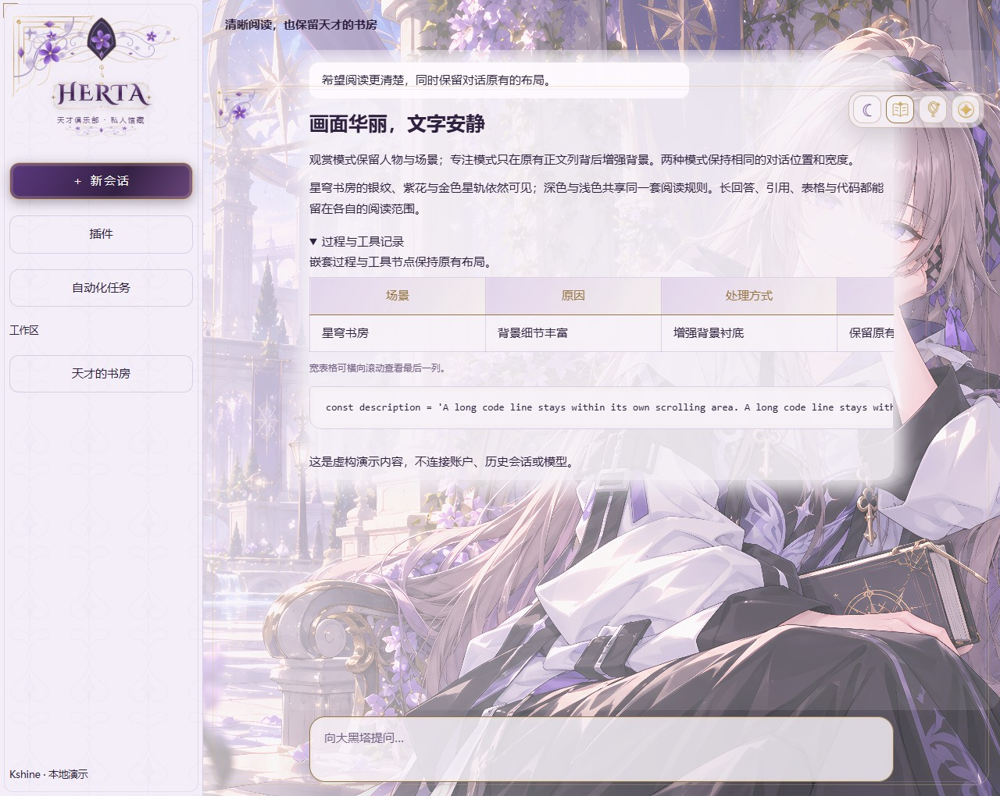

# The Herta Atelier · 大黑塔·天才书房

[代码许可：PolyForm Noncommercial 1.0.0](docs/LICENSE-SUMMARY.md) · 免费非商业使用、保留署名

**Kshine 的非官方 DSH 主题作品 · 0.4.0-beta.10 · 三场景动态 beta · Windows**

紫黑与晨光双主题，三幅内置大黑塔场景画像，银纹、紫花、宝石与钥匙的层叠框饰。
观赏模式保留立绘；专注模式在宿主原有正文列背后增加柔边衬底，切换保持消息与输入框布局。
面板、代码与输入框使用统一的紫调玻璃材质。藏镜收进右上工具栏，点击才展开，图库由用户管理。
静态／动态独立选择。完整安装包包含三幅背景、全部清晰度与 13 段无声视频：书房 5 段为 1820×1138，其余 8 段为 1212×758，均为 30fps。三场景均有实际视频动作；后台和减少动画会暂停，加载失败明确回退静态。部分素材仍为 beta 待实机复核，不宣称逐条美术或原生 DSH 全部通过。
右上工具条平时只留固定箭头；点击或停留片刻展开，闲置四秒后收起。设置或键盘操作期间保持展开，并随聊天面板边缘定位。

## 给第一次使用的朋友

1. 从 Releases 下载 **-theme.zip 完整主题包**并解压，内含三组人物背景与全部清晰度版本；当前为 beta。
2. 先运行一次 DSH，完全退出后，双击 **Install.cmd**。
3. 安装器联合安装代码与 13 段视频，完成校验、备份后，再打开 DSH。
4. 右上四角星打开设置；**OpenGallery.cmd** 打开你自己的图库，增删图片后重开藏镜刷新。

普通使用不需要编辑 JSON/YAML，也不需要安装 npm 依赖。需要 Node.js 22.19+（22.x）或 24+；脚本优先找 DSH 自带运行时。
Code → Download ZIP 是源码，主要给开发者；安装用户使用预先构建的安装包。
完整主题内置星穹书房、天才的房间、星间漫游三组画像，保留清晰/极清与深浅变体。`--core` 是不带画像的显式基础版选项，不作为默认交付。
从源码下载时，先运行 `node tools/build.mjs` 生成本地清单，再运行安装器；第一次体验优先使用 Releases 中的完整主题安装包。

## 安全安装与移除

- 默认安装到当前用户的 DSH desktop profile，支持自定义 DSH_HOME、profile 和数据目录。
- 原配置、旧链接先备份；只修改本主题的依赖、bundle 与带标记的主题启用区段。
- 重复安装不会重复注入；升级保留首次安装前的恢复基线。
- **Uninstall.cmd** 恢复原有主题配置与链接，保留图库和个人视频。
- **Check.cmd** 只报告状态，不修复、不重启、不修改配置。

维护方式见 [贡献指南](CONTRIBUTING.md)、[支持](SUPPORT.md)、[安全](SECURITY.md)和 [维护流程](docs/MAINTENANCE.md)。

详见 [安装与回滚](docs/INSTALL.md)、[验收记录](docs/ACCEPTANCE.md)、[兼容范围](docs/COMPATIBILITY.md)。

## 可选开屏

分享包不附官方 PV。把你可使用的 MP4/WebM/M4V/MOV 拖到 **ImportVideo.cmd**，再运行 **InstallWithBoot.cmd**。
开屏模块沿用 lxj5820/dsh-boot-animation 的 MIT 代码及其许可证，启用前检查随包依赖与个人视频。
正常提示为 **PRESS ANY KEY TO ENTER**；任意非输入法组合键可进入，声音由单独按钮控制。
推荐 H.264/AAC MP4 并做 faststart。原生视频的清晰度取决于用户导入片源。

## 开发与作品维护

~~~text
node tools/build.mjs
node --test tests/*.test.mjs
node tools/verify.mjs
node tools/preview.mjs
node tools/release.mjs
# 可选基础版：node tools/release.mjs --core
~~~

当前基准宿主为 Windows / DSH 0.2.1-rc.2。安装与模拟验收不等于重启后的实机验收；其他版本请先作为兼容性测试使用。
GitHub 第一次使用见 [Kshine 的发布步骤](docs/GITHUB-FIRST-STEPS.md)。欢迎提交问题时附 DSH 版本、缩放比例与复现步骤。

## 来源与许可

本项目不代表 HoYoverse / miHoYo 或 DeepSeek 官方。作者有权授权的代码采用 **PolyForm Noncommercial 1.0.0**：限许可允许的非商业用途，分发时保留许可与 Kshine 的 Required Notice。独立原创框饰采用 **CC BY-NC-SA 4.0**；字体、可选开屏和角色美术分别见 [NOTICE](NOTICE.md)。

这是**源码可用、非商业许可**的个人作品，不称为标准开源软件。AI 辅助制作、源码与成品的关系见 [源码与 AI 说明](docs/SOURCE-AND-AI.md)。
官方 PV、第三方同人镜图、私人图库、旧聊天截图均不在分享包内。三组由用户生成并确认的角色背景及主题演示截图随完整主题提供。角色形象的相关权利不因项目代码许可证而转移。

本轮候选与验收边界见 [动态书房与工具条](docs/REVIEW-2026-10-25.md)。本地预览运行后打开 http://127.0.0.1:43249/ ，可对照原片直接衔接和180ms短叠化。候选未安装、未发布，真实 DSH 性能与美术观感仍须单独验收；旧版记录保留作历史证据。

本次升级后如需回到升级前的精确版本，完全退出 DSH 后运行 **Rollback.cmd**；它与恢复首次安装前状态的 **Uninstall.cmd** 不同。图库、个人开屏和无关配置保留。真实 DSH 试装由下载验收阶段完成。
